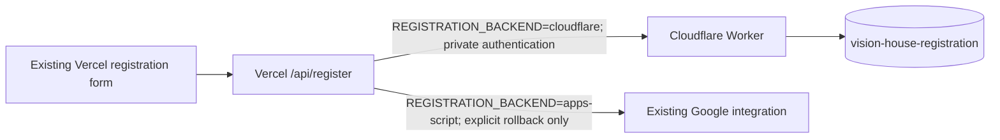

# RCCG Vision House registration: Cloudflare Worker + D1

This branch prepares the migration for an access-protected Vercel Preview.
Cloudflare deployment and secret configuration were completed separately by the
owner, who reports the Worker gate remains closed. Preparing this branch does
not change Cloudflare/Vercel settings, submit registrations or deploy Production.
Existing Google diagnostic changes in the working tree are preserved separately.
The owner-specific `wrangler.jsonc` is ignored; only the sanitized
`wrangler.example.jsonc` template is version controlled.

The existing website and form stay on Vercel. The browser still submits the same
six fields and `Idempotency-Key` to `/api/register`. Vercel validates the request
and sends it to the selected backend. Only Vercel holds the Worker authentication
secret; only the Worker holds the D1 database binding. There is no public records
endpoint and no new Google/Supabase dependency when Cloudflare is selected.



## Behavior and security

- Vercel and the Worker use the exact existing validation functions from
  `lib/registration-validation.js`. The frontend and design are unchanged.
- Both server-side `REGISTRATION_ENABLED` gates must be `true` before D1 writes.
  Worker configuration ships closed. Missing/unknown backend configuration
  fails closed; an unset Vercel backend selector retains the existing Google path.
- The Worker requires a separate, private, 32-256 character printable ASCII
  `REGISTRATION_WORKER_SECRET` as a Bearer token and the exact approved HTTPS
  website Origin. Web Crypto MAC verification authenticates the token.
  CORS is an additional browser restriction, not a substitute for authentication.
- Requests are limited to 4 KiB, six string fields, one UUID-v4 submission ID,
  and a trusted pseudonymous abuse digest computed by Vercel from its trusted
  client-IP header. Secrets and raw IP addresses are not stored in D1 records.
- Prepared SQL protects against SQL injection. Phone numbers remain TEXT,
  including leading zeroes and country codes. Honeypot values are rejected.
- `submission_id` is the primary key and `application_id` is unique. A D1
  transactional batch conditionally inserts and reads the resulting record.
  Concurrent requests cannot append a second record for an existing ID.
- Matching same-ID requests return the original receipt, preserving harmless
  name/email/phone formatting replay rules. Changed details return a conflict.
  Replays never update status, review dates or existing personal data.
- Fresh writes require exact field preservation, a matching stored payload hash,
  the generated application ID, a timestamp and `Pending` status before success.
  Database errors/lost responses remain unconfirmed with `retrySafe: false`.
  Neither Vercel nor the Worker automatically retries a registration POST.
- Edge rate limiting bounds attempts to approximately 30 per IP digest/minute.
  D1 atomically caps NEW registrations at 5 per IP digest and 100 globally per
  fixed 15-minute window. Receipt replays do not consume new-registration quotas.
  Fixed windows permit bursts across a boundary; shared-IP users share quotas.
- Rate counters expire; registration records are never automatically deleted.
  D1 quotas, indexes and counter writes still count toward free-plan usage.
- Application logs contain only fixed event names and stages, never request
  bodies, identifiers, secrets, private URLs or driver exceptions. Invocation
  logs are disabled. Do not independently enable request-body/header logging.
- Worker source/configuration, SQL, tests and local credential files are excluded
  from Vercel static publication. The Worker source is bundled locally by Wrangler.

Cloudflare documents [transactional D1 batches](https://developers.cloudflare.com/d1/worker-api/d1-database/),
[rate-limit accuracy](https://developers.cloudflare.com/workers/runtime-apis/bindings/rate-limit/#accuracy),
and [D1 free-plan quotas and scale-to-zero billing](https://developers.cloudflare.com/d1/platform/pricing/).
No laptop server or scheduled keep-alive is needed after deployment. Free-plan
quotas and service availability still apply.

## Local checks (safe to run now)

Use Node.js 24 or a recent Node.js 22 release supporting `node:sqlite` (22.13+).
From the repository root:

```powershell
npm.cmd test
```

The D1 harness executes the actual migration/SQL against isolated in-memory
SQLite and models transactional D1 batch behavior. All network transports in
these repository tests are intercepted. They never use live credentials.

For Cloudflare tooling, from the repository root:

```powershell
Set-Location .\cloudflare\registration
npm.cmd ci
# A fresh checkout needs a local config. Preserve an existing configured file.
if (-not (Test-Path -LiteralPath .\wrangler.jsonc)) {
  Copy-Item -LiteralPath .\wrangler.example.jsonc -Destination .\wrangler.jsonc
}
npm.cmd run check
npm.cmd run test:local
```

`check` is `wrangler deploy --dry-run --outdir dist`: it only builds locally.
`test:local` uses the built bundle, native workerd, an isolated local D1 database,
and fictional records. It never uses remote bindings or account credentials.
Tool versions are pinned in this folder's package/lock files; the website's root
package and Node engine settings are unchanged.

The complete local migration suite passed 313 repository tests (including 57
Cloudflare tests), along with syntax/whitespace checks and the Wrangler dry-run.
The Preview commit intentionally excludes the pending Google diagnostic changes
and their dependent tests; its exact committed snapshot has 296 repository tests.
The native smoke suite could not execute because workerd crashes at startup on
this Windows machine with an access violation/stack overflow. A minimal Worker
without any registration code crashes too, including outside the sandbox.
This remains a verification gap: run the smoke suite on a working local runtime
or complete an explicitly authorized protected Preview test before public cutover.
No system runtime installer or Windows settings were changed to bypass it.

## Cloudflare setup and deployment reference

The owner reports the database, Worker and shared secret are already configured.
Do not repeat migrations, deploy the Worker or rotate a secret just to publish
the Vercel Preview branch. The following steps are retained for a fresh setup.

1. Review/approve the migration first. Do not change the live Google project or
   existing Google credentials. Stay on the Workers Free plan if free operation
   is required. Use the Cloudflare account containing the existing
   `vision-house-registration` database; do not create it again.

2. In `cloudflare/registration`, authenticate locally:

   ```powershell
   npx.cmd wrangler login
   ```

3. On a fresh checkout, copy `wrangler.example.jsonc` to the ignored local
   `wrangler.jsonc` if that local file does not exist. In Cloudflare's D1 dashboard,
   privately copy the existing database UUID into
   `wrangler.jsonc`'s `database_id` placeholder. Keep `database_name` exactly
   `vision-house-registration` and binding `DB`. Set
   `REGISTRATION_ALLOWED_ORIGIN` to the exact approved HTTPS website origin,
   with no path/trailing slash. Keep `REGISTRATION_ENABLED` as `"false"`.
   Ensure rate-limit namespace `10001` is unused by another account application;
   otherwise choose another unused positive integer string. Keep the actual
   database ID in the ignored local config and keep the tracked template's
   placeholder unchanged. No secrets belong in either config or in chat.

4. Review the additive migration and any existing `vh_` tables before applying.
   It creates registration/limit tables, indexes and a counter trigger. It does
   not import, delete or alter Google records. If those table names already exist
   with a different schema, stop and review rather than replacing them.

   ```powershell
   npx.cmd wrangler d1 migrations list vision-house-registration --remote
   npx.cmd wrangler d1 migrations apply vision-house-registration --remote
   ```

5. Deploy the Worker CLOSED, then configure its authentication secret privately:

   ```powershell
   npx.cmd wrangler deploy
   npx.cmd wrangler secret put REGISTRATION_WORKER_SECRET
   ```

   Generate a fresh 64-character random hexadecimal token using a trusted
   password manager. Enter it at Wrangler's secret prompt, store it securely,
   and later enter the identical value as a private Vercel server environment
   variable. This is a bridge secret, not a Cloudflare API/account token.
   Do not change/reuse the existing Google secret. Do not put this value in
   `vars`, browser JavaScript, commands, screenshots or chat.

6. Copy the actual canonical Worker `https://<worker>.<account>.workers.dev`
   endpoint privately; append `/api/register` when configuring Vercel.
   Alternate paths, redirects and custom domains are deliberately not accepted
   by this first gateway implementation. No browser configuration needs changing.

Cloudflare's [migration guide](https://developers.cloudflare.com/d1/reference/migrations/)
and [Wrangler commands](https://developers.cloudflare.com/workers/wrangler/commands/)
describe these commands. They are deployment instructions, not an authorization
to run them automatically during Preview branch preparation.

## Protected Preview verification and public cutover

1. Leave Production's backend selector/settings unchanged during verification.
   In Vercel, prepare an access-protected Preview containing the reviewed code.
   Obtain its exact origin privately. While CLOSED, update the new Worker's
   `REGISTRATION_ALLOWED_ORIGIN` to this exact Preview origin and deploy that
   reviewed config. Production remains connected to the existing Google backend.

2. Configure only that Preview's SERVER environment variables:

   | Setting | Value |
   | --- | --- |
   | `REGISTRATION_BACKEND` | `cloudflare` |
   | `REGISTRATION_WORKER_URL` | Actual canonical Worker URL ending in `/api/register` |
   | `REGISTRATION_WORKER_SECRET` | Same private token entered at the Wrangler prompt |
   | `REGISTRATION_ALLOWED_ORIGIN` | Exact protected Preview origin |
   | `REGISTRATION_ENABLED` | `false` initially |

   Do not use `NEXT_PUBLIC_`, `PUBLIC_` or other browser-exposed secret variables.
   Vercel settings apply to a new deployment. The three Worker variables alone
   do not establish the Preview API gate or allowed origin: verify the last two
   settings in Preview scope explicitly. Until the new deployment's origin is
   known, keep the API closed. No Google credentials are required for Cloudflare
   mode. Initially both gates stay closed. Vercel Authentication / deployment
   protection is an account setting that Git source alone cannot verify.

3. After separate approval for a controlled test, open ONLY the Preview backend
   gate and the new Worker's gate (`"true"` in its reviewed config plus deployment).
   Perform one explicitly authorized fictional registration from the protected
   form and privately verify its receipt against one D1 row. Repeating the SAME
   ID must return the original receipt without adding a row; changed data with
   that ID must conflict. Keep existing records and any fictional QA record.
   Do not run automated live POSTs or repeated browser submissions after an
   uncertain result. Native local tests cover failures without touching D1 online.

4. Once verification passes, close the new Worker and Preview gates. For an
   approved production cutover, temporarily close Vercel Production's API gate
   and redeploy. Let in-flight submissions finish and reconcile uncertain
   applications in their original store before switching backends.

5. Set the new Worker's exact allowed origin to the existing public church
   website and deploy it CLOSED. Configure the same four Cloudflare settings
   in Vercel Production with `REGISTRATION_ENABLED=false`, then deploy the
   reviewed Vercel code/settings. Preserve all existing Google settings for rollback.

6. After approved verification, open the Worker gate/deploy its config, then
   open the Vercel Production gate/redeploy the existing Vercel project. Both
   gates must be open. No frontend/design/sermon changes are needed.

## Explicit rollback

Close the Vercel API gate and reconcile in-flight/uncertain D1 submissions first.
Set only Vercel's `REGISTRATION_BACKEND=apps-script`, retaining the original
Google endpoint/secret, then deploy the selected configuration after approval.
Reopen registration only when that backend is verified healthy. Google still
has its previously diagnosed `WRITE_UNCERTAIN` issue; rollback preserves access
to the old implementation, not a claim that it is working.

Keep all D1 and Google records. The stores are not synchronized and neither
backend can deduplicate against the other store. Never forward an uncertain
submission to the other backend or silently retry it there. A future data-import
or admin/review UI is a separate task; this migration provides no public read API.

## File inventory

- `api/register.js`: explicit backend selection; original browser response contract.
- `lib/registration-validation.js`: original server validation extracted unchanged.
- `lib/registration-cloudflare.js`: authenticated, bounded, no-redirect Worker bridge.
- `lib/registration-upstream.js`: exports its existing bounded JSON reader for reuse;
  Google request behavior remains intact.
- `cloudflare/registration/src/worker.mjs`: Worker API, authentication, CORS, D1 transactions.
- `cloudflare/registration/migrations/0001_registration.sql`: additive D1 schema/counters.
- Worker `wrangler.example.jsonc`, `package.json`, `package-lock.json`,
  `tools/local-smoke.cjs`, and this guide: closed deployment template, pinned
  tooling and native checks. The actual `wrangler.jsonc` remains ignored/local.
- `.env.example`: names/placeholders only; `.env.local` and live settings were not changed.
- `.gitignore`, `.vercelignore`, `vercel.json`: keep Worker/private tooling out of publication.
- `tests/registration-cloudflare.test.js`, `tests/helpers/d1-harness.js`: Worker,
  actual SQLite migration/SQL and Vercel bridge regression coverage.
- `tests/dev-server.test.js`, `tests/registration-frontend.test.js`: outdated closed-
  frontend assumptions corrected for the already approved public form; backend
  and explicitly closed-frontend gate protection remains tested. No frontend code changed.
